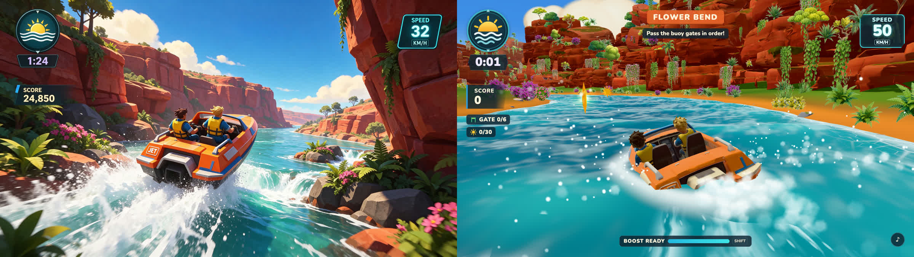
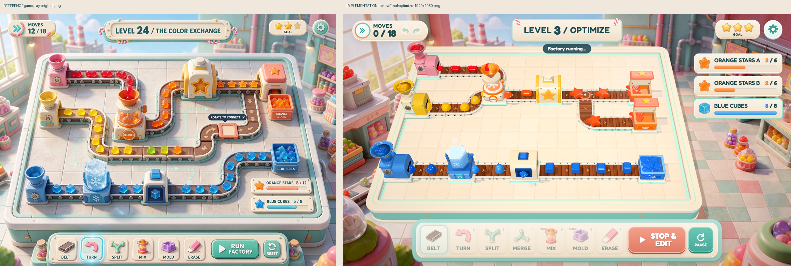
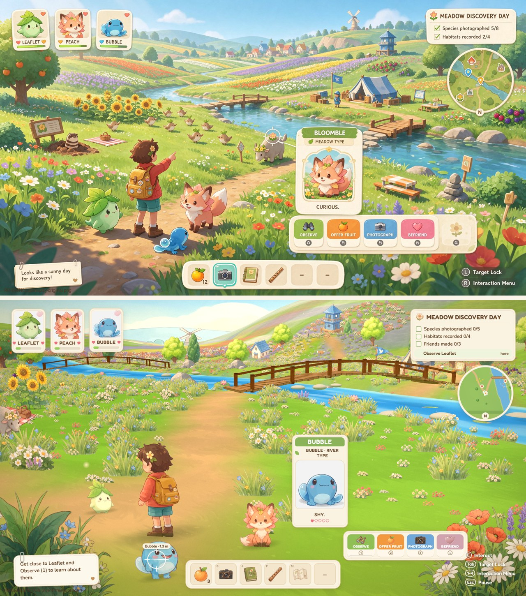
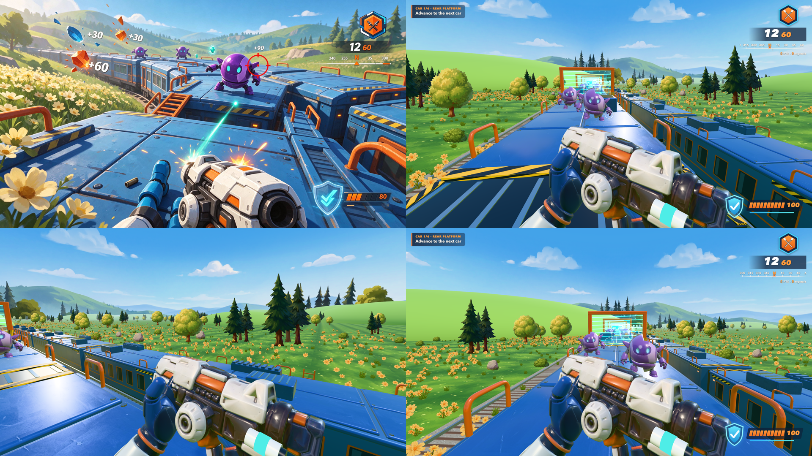

# Reference to Game

**Turn images, videos, sheets, sketches, models, audio, links or a written idea into a playable game—without losing its visual identity.**

An input-agnostic skill and toolkit for coding agents. It gives Claude Code, Codex, Cursor and other agents a workflow for preserving **style, colors, shapes, materials, camera, motion and UI**, then turning that direction into real gameplay.



*Reference → playable implementation. The four games below were developed from image, sheet and video references. Their source and runtime assets are included.*

[Install](#install) · [Try a game](#four-worked-games) · [Use](#use) · [Tools](#tools) · [Evidence](docs/EVIDENCE.md) · [Scope](docs/SCOPE.md)

## Why references matter

A prompt can describe “colorful” or “painterly” without specifying the decisions that make a particular game recognizable. References make those decisions concrete: the size of an accent color, a character's proportions, the softness of a shadow, the camera's distance, the way a UI panel feels like paper.

The challenge is carrying those decisions through implementation. A game can compile, run smoothly and have working mechanics while still looking unrelated to its reference. This workflow treats **visual identity and playability as separate requirements**. Neither can hide a failure in the other.

- **Inspect before implementing.** Assign authority separately for appearance, identity, mechanics, motion and UI. Preserve originals and distinguish observation from invention.
- **Lock style before expanding scope.** Build a small polished scene, compare it to the reference, and fix the largest mismatch before multiplying assets and levels.
- **Choose the right representation.** Painted sprites, 2.5D layers, procedural geometry, generated meshes and shaders can coexist. Full 3D is not automatically the most faithful choice.
- **Build actual gameplay.** Input, rules, state-driven UI, goals, recovery and restart. A screenshot or prerecorded showcase is not the implementation.
- **Generate assets deliberately.** Optional fal workflows for images, models, textures, animation studies, audio and music, with durable job IDs and duplicate-submission protection.
- **Deliver inspectable evidence.** Source-bound reviews, reference comparisons, rule tests, real input-driven playthroughs, measured performance and honest limitations.

## Any reference, an appropriate workflow

| Starting point | What the agent does |
|---|---|
| One screenshot, painting or sketch | Extracts style and composition; authors missing mechanics explicitly |
| Gameplay video or animation | Inspects motion and events; separates camera movement from object movement and generated defects |
| Full asset sheet or mood board | Reads the whole design system, then identifies useful regions; no mandatory grid or scene count |
| A model or existing asset folder | Inspects geometry, material, scale, rigs and identity before integration |
| Music or audio | Uses sound as mood/timing evidence and designs the missing visual direction |
| A URL, PDF or design document | Opens it with the appropriate viewer/connector and records what was actually inspected |
| A text-only idea | Designs a coherent art direction and playable loop; labels the visual choices as authored |
| Mixed references | Resolves which source governs each dimension rather than averaging conflicting styles |

**Input-agnostic does not mean universal automatic decoding.** The CLI handles intake and common media inspection; specialized formats and inaccessible links need an appropriate tool. The coding agent performs visual judgment and implementation. [Exact boundaries →](docs/SCOPE.md)

The default implementation profile is **Three.js + TypeScript + Vite**, with support for 2D, layered 2.5D and full 3D. The contracts are engine-neutral; other engines can follow the workflow, but this release does not ship verified project generators for them.

## Four worked games

| Jetboat racing | Candy factory puzzle |
|---|---|
| [](examples/jungle-jetboat-jump/) | [](examples/jellyworks/) |
| **[Jungle Jetboat Jump](examples/jungle-jetboat-jump/)** — 3D boat and crew, painted vegetation, procedural water; ordered gates, pickups, boost, jumps and recovery. | **[Jellyworks](examples/jellyworks/)** — tactile machinery and candy; deterministic conveyors, mixing, molds, backpressure, edit/run modes and three solvable puzzles. |

| Painted meadow exploration | First-person train action |
|---|---|
| [](examples/petal-pals/) | [](examples/sunshine-train-battle/) |
| **[Petal Pals](examples/petal-pals/)** — painted directional characters in a 2.5D world; observe, feed, photograph, befriend, explore and save. | **[Sunshine Train Battle](examples/sunshine-train-battle/)** — cleaned generated meshes and a train-local world; shooting, shielding, reloading, jumping, checkpoints and restart. |

Each example includes **runnable source, runtime assets, original image, full development sheet, style contract, visual comparison and case notes**. Full raw generation archives are intentionally excluded. The cases predate this packaged skill; they are worked examples, **not a controlled with/without-skill benchmark**. Read their remaining differences and historical validation reports rather than assuming pixel-perfect reconstruction.

Run any example locally; no fal key is needed:

```bash
git clone https://github.com/gokayfem/reference-to-game.git
cd reference-to-game/examples/petal-pals/app
npm ci
npm run dev
```

Each game has its own controls, tests and build scripts. Reference art/generated media are demonstration material with separate reuse considerations; [credits and licensing](CREDITS.md).

## Install

**Claude Code plugin:**

```bash
claude plugin marketplace add gokayfem/reference-to-game
claude plugin install reference-to-game@reference-to-game
```

**Agents that support the skills CLI:**

```bash
npx skills add gokayfem/reference-to-game
```

Choose the `reference-to-game` skill and your agent. Or copy `skills/reference-to-game/` into the agent's supported skill directory. The skill is self-contained: the tools and supporting guides travel with it. For a chat assistant without local execution, use [the handoff prompt](adapters/chat-prompt.txt).

The CLI requires **Python 3.10+**. Intake, prompts, validation and fal bookkeeping use the standard library. Image tools additionally need Pillow; audio/video inspection needs `ffmpeg` and `ffprobe`. Runtime helper tests use Node 20+; the example games recommend Node 22+.

```bash
python3 -m pip install -r skills/reference-to-game/scripts/requirements.txt
```

## Use

Ask naturally:

> “Make a playable Three.js game from this image and full development sheet. The style and colors are the most important part. You can create fal assets.”

> “Use this ink illustration for appearance and this clip for movement. Build a small exploration game without changing the drawing style.”

> “Here is an existing prototype and a new art reference. Keep the rules, replace the visual direction, and show comparisons.”

Or start a portable case explicitly:

```bash
python3 skills/reference-to-game/scripts/r2g.py init cases/my-game \
  --input /path/to/concept.png \
  --input /path/to/movement.mp4 \
  --brief "Make this playable while preserving its style and colors"

python3 skills/reference-to-game/scripts/r2g.py inspect cases/my-game
python3 skills/reference-to-game/scripts/r2g.py prompt cases/my-game \
  --out cases/my-game/IMPLEMENT.txt
```

Give the case and the prompt to your coding agent. It fills the style/game/asset contracts, implements the game, compares it against the reference, then plays and verifies it. The full reusable prompt is also available at [prompts/reference-to-game.md](prompts/reference-to-game.md).

## Tools

| Command | What it actually does |
|---|---|
| `init` | Copies references without changing them, hashes them, records URLs, creates neutral case contracts |
| `inspect` | Reads common media metadata, text previews and representative video frames; records unsupported inspection explicitly |
| `palette` | Samples named semantic color roles from explicit normalized image coordinates |
| `compare` | Makes a labelled reference/implementation comparison without stretching or inventing a similarity score |
| `prompt` | Writes a concrete implementation handoff from a case inventory |
| `install-core` | Copies optional tested runtime helpers into the case |
| `review-page` | Builds a portable offline viewer for source media and review evidence |
| `freeze` | Fingerprints source/contracts, records a snapshot manifest and resets review signoffs |
| `evidence` | Attaches hashed files and an author's review notes to one check |
| `validate --release` | Checks contract completeness, reference integrity and review freshness; does not judge aesthetics |
| `fal-submit` | Plans an offline job; `--execute` submits under explicit generation settings and estimated budget |
| `fal-status` | Polls one recorded job without resubmitting it |

[Command examples and contracts →](skills/reference-to-game/references/cli.md)

The optional JavaScript helpers cover a bounded fixed-step clock, once-only reward IDs, swept-circle collision, frame-independent damping, input cleanup and seeded randomness. They contain no default palette, camera, character, level or genre.

## fal asset generation

fal is optional. The game runs on local assets, not live generation calls. Agents can choose suitable current endpoints for image editing, textures, sprites, 3D meshes, audio, music or motion references, then review and integrate the outputs.

The adapter persists intent **before** a potentially billable request, stores request IDs and queue URLs, deduplicates identical local jobs and reserves estimated budget. An uncertain POST stays **ambiguous** until reconciled; it is never silently retried. This is not an exactly-once billing guarantee or a server-side spending cap. Model schemas and pricing must be checked when used. [Full workflow →](skills/reference-to-game/references/fal.md)

## Verification

```bash
python3 -m unittest discover -s tests -p 'test_*.py' -v
node --test tests/runtime.test.mjs
python3 tests/check_repo.py
```

The tests cover mixed inputs and unusual dimensions, reference preservation/tampering, path escape, palette sampling, stale review, runtime invariants, local fal deduplication, uncertain submissions and budget boundaries. They run without paid API calls. CI also builds and tests all four examples.

A review pass means the required evidence is present and tied to the current source. It **does not** prove that a game is artistically faithful or that a claimed playthrough occurred; inspect the captures, logs and recordings. [Evidence and limits →](docs/EVIDENCE.md)

## Repository

```text
skills/reference-to-game/  installable skill, supporting guides, CLI, runtime helpers
examples/                 four runnable games and their references/comparisons
prompts/                  full reference-to-game implementation prompt
gallery/                  reference-to-game comparison images
tests/                    toolkit, negative-case and runtime tests
evals/                    proposed agent evaluation protocol, not claimed results
docs/                     architecture, scope and measured evidence
.claude-plugin/            plugin and marketplace manifests
```

Related work: [shader-skills](https://github.com/gokayfem/shader-skills) · [video-to-blender](https://github.com/gokayfem/video-to-blender) · [video-to-physics](https://github.com/gokayfem/video-to-physics) · [video-to-css](https://github.com/gokayfem/video-to-css).

Toolkit code and documentation: MIT. See [CREDITS.md](CREDITS.md) for example media and third-party attribution.
