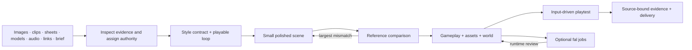

# Architecture

The repository has three layers:

1. **Agent skill:** progressive guidance for evidence intake, visual identity, gameplay, asset production and verification. This is where creative judgment and implementation happen.
2. **Portable tooling:** a Python case/inspection/review CLI, a durable fal queue ledger, and optional engine-neutral JavaScript runtime helpers. These automate repeatable bookkeeping and known invariants; they do not automatically generate an arbitrary game from a file.
3. **Worked games:** four complete Three.js implementations with their original style references, comparison captures and source. They demonstrate different representation choices and are independent of the core skill.

`init` is offline and copies supplied local evidence without transformation. `inspect` performs format-specific metadata reads and optional video frame extraction. `palette` samples explicit semantic locations. `compare` produces a labelled visual artifact without a fake quality score. `freeze` fingerprints source and resets review; `evidence` records author attestations with hashes; `validate --release` checks their completeness and freshness. No check substitutes for inspection of the actual game.

The fal adapter has states `submitting → submitted/running → completed/failed`, with `ambiguous` after an uncertain POST. Intent is persisted before transmission, queue-returned URLs are verified, and a local asset/endpoint/input hash prevents duplicate local submissions. A transport failure is not automatically retried. This is conservative client bookkeeping, not exactly-once billing.
