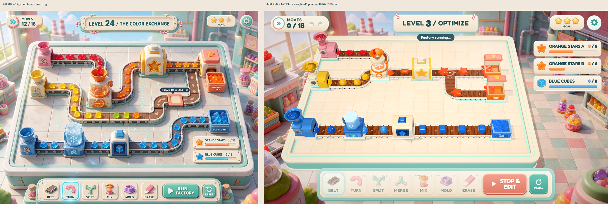

# Jellyworks

**Conveyor routing puzzle.** Repair conveyor routes, combine ingredients, transform candy and satisfy three puzzles.



## Run

```bash
cd examples/jellyworks/app
npm ci
npm run dev
```

Default development URL: http://127.0.0.1:5172/. Controls and build scripts: [app/README.md](app/README.md).

## What this case demonstrates

Representation: **Procedural toy machines + generated room art/icons + translucent candy**.

The style contract preserves cream and mint panels, tactile rounded machines and wooden belts, distinct translucent candy colors, large friendly typography. Camera: Fixed elevated board camera with orthographic-like readability.

[Original reference](references/ref-001-gameplay-original.png) · [Full development sheet](references/ref-002-asset-sheet.png) · [Style contract](style.json) · [Game source](app/src)

## Evidence and limits

The original implementation's playthroughs, measurements and limitations are recorded in [HISTORICAL-REPORT.txt](HISTORICAL-REPORT.txt). Paths in that report describe its original production workspace; the multi-gigabyte generation archive and full recordings are not bundled here. Source and runtime assets, the visual comparison, full sheet and the original brief are included. Fresh repository checks are reported in [the evidence log](../../docs/EVIDENCE.md).

Remaining visual/technical differences: Candy spacing is rule-driven and differs from the illustration; transmission uses an adaptive quality fallback.

This example predates the packaged skill. It is a worked case, not a controlled skill-effectiveness benchmark. The root review.json remains pending until a new source-bound review is performed; historical results are not silently promoted to fresh signoffs.

Reference art and generated assets are demonstration material, separate from the code's MIT license. See [credits](../../CREDITS.md).
