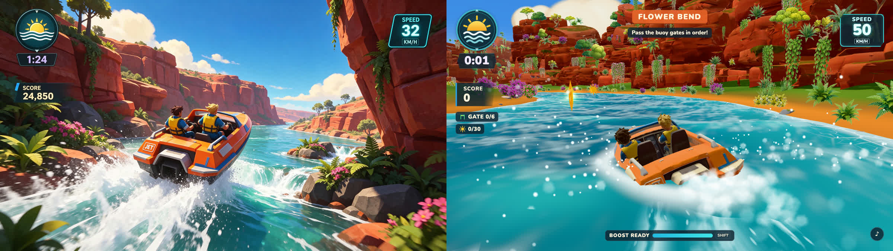

# Jungle Jetboat Jump

**Arcade river racing.** Steer through ordered gates, collect suns, clear the canyon leap and reach the lagoon.



## Run

```bash
cd examples/jungle-jetboat-jump/app
npm ci
npm run dev
```

Default development URL: http://127.0.0.1:5171/. Controls and build scripts: [app/README.md](app/README.md).

## What this case demonstrates

Representation: **3D meshes + painted environment cards + procedural water**.

The style contract preserves orange/blue boat with exactly two crew, turquoise water against red sandstone, yellow vests and dense painted greenery, cyan outlined speed card. Camera: Chase camera behind the boat, rear three-quarter composition; optional cockpit view.

[Original reference](references/ref-001-gameplay-original.png) · [Full development sheet](references/ref-002-asset-sheet.png) · [Style contract](style.json) · [Game source](app/src)

## Evidence and limits

The original implementation's playthroughs, measurements and limitations are recorded in [HISTORICAL-REPORT.txt](HISTORICAL-REPORT.txt). Paths in that report describe its original production workspace; the multi-gigabyte generation archive and full recordings are not bundled here. Source and runtime assets, the visual comparison, full sheet and the original brief are included. Fresh repository checks are reported in [the evidence log](../../docs/EVIDENCE.md).

Remaining visual/technical differences: Spray curl, gloss and some terrain framing still differ from the original.

This example predates the packaged skill. It is a worked case, not a controlled skill-effectiveness benchmark. The root review.json remains pending until a new source-bound review is performed; historical results are not silently promoted to fresh signoffs.

Reference art and generated assets are demonstration material, separate from the code's MIT license. See [credits](../../CREDITS.md).
