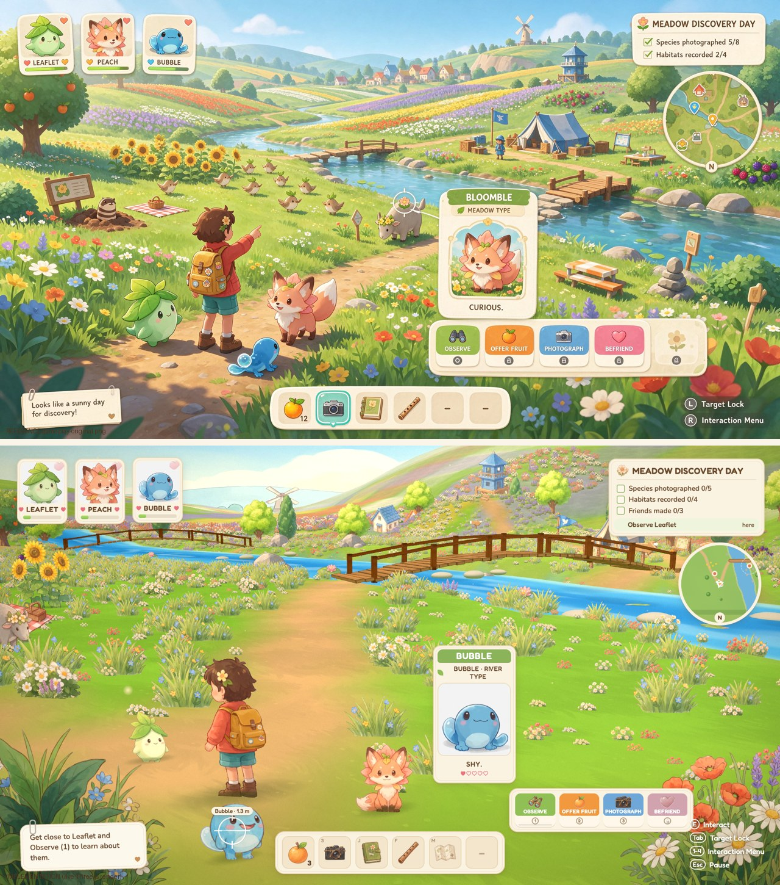

# Petal Pals

**Meadow exploration.** Observe, feed, photograph and befriend three companions while recording meadow wildlife and habitats.



## Run

```bash
cd examples/petal-pals/app
npm ci
npm run dev
```

Default development URL: http://127.0.0.1:5173/. Controls and build scripts: [app/README.md](app/README.md).

## What this case demonstrates

Representation: **Painted directional sprites + 3D terrain and depth-aware foliage**.

The style contract preserves painterly meadow with flower rows, paper cream UI and warm brown text, coral jacket, teal shorts, yellow backpack, Leaflet, Peach and Bubble retain their identities. Camera: Third-person illustration framing with depth-aware painted characters.

[Original reference](references/ref-001-gameplay-original.png) · [Full development sheet](references/ref-002-asset-sheet.png) · [Style contract](style.json) · [Game source](app/src)

## Evidence and limits

The original implementation's playthroughs, measurements and limitations are recorded in [HISTORICAL-REPORT.txt](HISTORICAL-REPORT.txt). Paths in that report describe its original production workspace; the multi-gigabyte generation archive and full recordings are not bundled here. Source and runtime assets, the visual comparison, full sheet and the original brief are included. Fresh repository checks are reported in [the evidence log](../../docs/EVIDENCE.md).

Remaining visual/technical differences: The 2.5D interpretation and camera differ from the original painting; assets are designed for constrained views.

This example predates the packaged skill. It is a worked case, not a controlled skill-effectiveness benchmark. The root review.json remains pending until a new source-bound review is performed; historical results are not silently promoted to fresh signoffs.

Reference art and generated assets are demonstration material, separate from the code's MIT license. See [credits](../../CREDITS.md).
