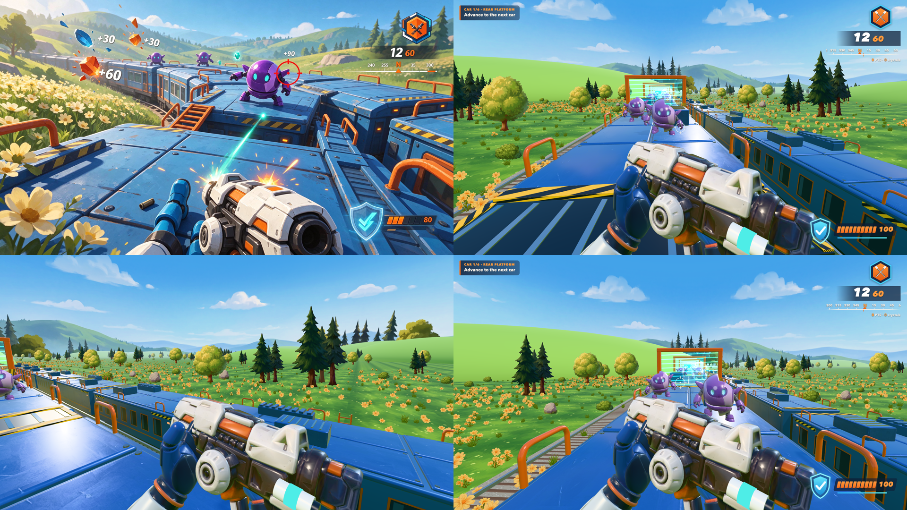

# Sunshine Train Battle

**First-person train action.** Clear purple robots across six train cars, jump gaps, manage ammo and shield, and reach the engine.



## Run

```bash
cd examples/sunshine-train-battle/app
npm ci
npm run dev
```

Default development URL: http://127.0.0.1:5174/. Controls and build scripts: [app/README.md](app/README.md).

## What this case demonstrates

Representation: **Generated cleaned meshes + train-local simulation + moving scenery**.

The style contract preserves blue train with orange rails, purple robots and turquoise eyes, white/orange blaster and blue gloves, sunny flower countryside. Camera: First-person roof-level camera with visible blaster and two hands.

[Original reference](references/ref-001-gameplay-original.png) · [Full development sheet](references/ref-002-asset-sheet.png) · [Style contract](style.json) · [Game source](app/src)

## Evidence and limits

The original implementation's playthroughs, measurements and limitations are recorded in [HISTORICAL-REPORT.txt](HISTORICAL-REPORT.txt). Paths in that report describe its original production workspace; the multi-gigabyte generation archive and full recordings are not bundled here. Source and runtime assets, the visual comparison, full sheet and the original brief are included. Fresh repository checks are reported in [the evidence log](../../docs/EVIDENCE.md).

Remaining visual/technical differences: The track is straight instead of curved; hand poses and robot deformation are simpler than a skeletal animation system.

This example predates the packaged skill. It is a worked case, not a controlled skill-effectiveness benchmark. The root review.json remains pending until a new source-bound review is performed; historical results are not silently promoted to fresh signoffs.

Reference art and generated assets are demonstration material, separate from the code's MIT license. See [credits](../../CREDITS.md).
